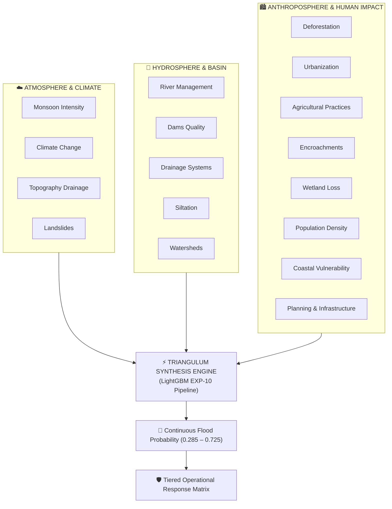
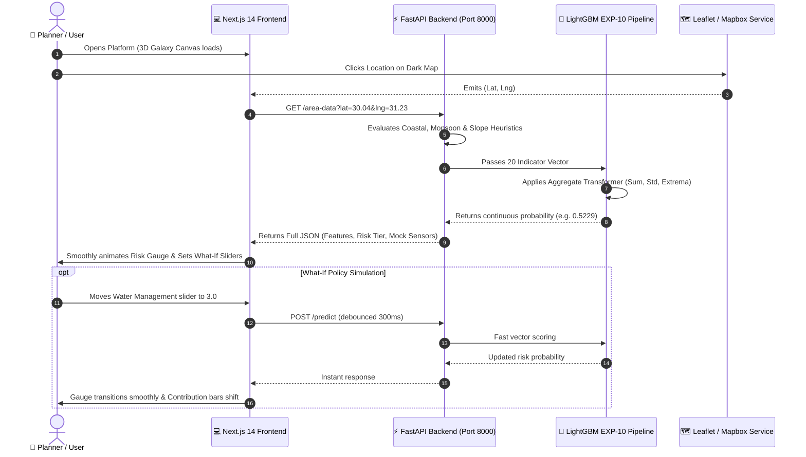

<div align="center">

# 🛰️ TRIANGULUM
### Planetary Flood Synthesis & Early Vulnerability Intelligence System
**NASA Space Apps Challenge 2026**

[](https://nextjs.org/)
[](https://fastapi.tiangolo.com/)
[](https://lightgbm.readthedocs.io/)
[](https://github.com/Mostafa-Zhran/Nasa-Space-App)
[](https://threejs.org/)
[](https://plotly.com/)
[](LICENSE)

<br/>

> **"Floods are not single-variable meteorological accidents. They represent an interconnected breakdown across Atmosphere, Hydrosphere, and Anthroposphere."**

[Explore Live Web App](http://localhost:3000) • [Training Data Dashboard](http://localhost:3000/dashboard) • [Interactive API Docs](http://127.0.0.1:8000/docs) • [NASA Submission Document](NASA_SPACE_APPS_SUBMISSION.md)

</div>

---

## 📌 Table of Contents

- [🌌 Executive Overview](#-executive-overview)
- [✨ Core Capabilities & Innovations](#-core-capabilities--innovations)
- [🛰️ NASA & Partner Earth Observation Data](#️-nasa--partner-earth-observation-data)
- [📐 The Scientific Concept: Planetary Triangulation](#-the-scientific-concept-planetary-triangulation)
- [🧠 Machine Learning Benchmark & Winning EXP-10 Model](#-machine-learning-benchmark--winning-exp-10-model)
- [🏗️ End-to-End System Architecture](#️-end-to-end-system-architecture)
- [📊 Interactive Plotly Analytics Dashboard](#-interactive-plotly-analytics-dashboard)
- [🗺️ Geospatial Engine & Mapbox Integration](#️-geospatial-engine--mapbox-integration)
- [⚡ Quick Start Guide (Run Locally)](#-quick-start-guide-run-locally)
- [☁️ Cloud Deployment (Railway + Vercel)](#️-cloud-deployment-railway--vercel)
- [📂 Repository Structure](#-repository-structure)
- [📄 Official NASA Submission Document](#-official-nasa-submission-document)

---

## 🌌 Executive Overview

Flooding accounts for over **40% of all natural disaster fatalities and economic destruction globally**. Conventional warning systems often fail because they treat inundation as an isolated rain event, ignoring critical human and infrastructural vulnerabilities.

**TRIANGULUM** is an end-to-end planetary intelligence platform engineered for the **NASA Space Apps Challenge**. It fuses NASA Earth Observation indicators across a **20-dimensional feature space** trained on over **1,117,957 geographical benchmark records**.

Powered by an optimized **LightGBM regressor** coupled with custom **non-linear statistical aggregate transformers (`feature_engineering.py`)**, TRIANGULUM achieves a validated **$R^2 = 0.8685$** and an **$RMSE = 0.01849$**. The platform equips disaster mitigation authorities with real-time geospatial targeting, counterfactual "What-If" scenario simulations, and automated operational contingency matrices.

---

## ✨ Core Capabilities & Innovations

```
┌─────────────────────────────────────────────────────────────────────────────┐
│                            TRIANGULUM PLATFORM                              │
├──────────────────────┬──────────────────────┬───────────────────────────────┤
│ 🌌 3D WebGL Galaxy   │ 🗺️ Leaflet / Mapbox  │ 🎛️ Counterfactual What-If     │
│ Celestial stellar    │ Dark-v11 tiles with  │ Real-time policy adjustments  │
│ simulation with      │ global Nominatim     │ across 4 groups with 300ms    │
│ mouse parallax       │ pin search           │ debounced AI re-inference     │
├──────────────────────┼──────────────────────┼───────────────────────────────┤
│ 🎯 Rotating Gauge    │ 📊 Plotly Dashboard  │ 🛡️ Operational Protocols      │
│ Animated SVG circle  │ 13 deep analytical   │ Actionable tiered response    │
│ with geometric       │ charts over 1.12M    │ matrix based on statistical   │
│ triangle motif       │ benchmark samples    │ training distributions        │
└──────────────────────┴──────────────────────┴───────────────────────────────┘
```

1. **Planetary Triangulation 3D Canvas:** Interactive Three.js WebGL visualization demonstrating the convergence of Atmosphere, Hydrosphere, and Anthroposphere with procedural starfield and spiral galaxy rotation.
2. **Zero-Latency Geospatial Pinning:** Interactive dark basemap supporting coordinates reverse-geocoding, smooth animated fly-to transitions, and automated coordinate heuristic inference.
3. **What-If Scenario Simulation Engine:** Four independent policy levers allowing planners to test interventions (e.g., dam repairs, reforestation, drainage upgrades) and observe live risk delta shifts.
4. **Transparent AI Lineage:** Honest indicators explicitly differentiating geographically derived features from assumed neutral baselines.
5. **Scientific Plotly Analytics Dashboard (`/dashboard`):** A standalone, distraction-free analytical control center with parallel coordinate hyperparameter tracking, residual error distributions, and feature importance error bars.

---

## 🛰️ NASA & Partner Earth Observation Data

TRIANGULUM maps its 20 physical dimensions directly to active NASA and partner space missions:

| NASA / Partner Mission | Indicator Mapped | Scientific Application |
| :--- | :--- | :--- |
| **NASA GPM (Core Observatory)** | `MonsoonIntensity`, `ClimateChange` | Dual-frequency precipitation radar (DPR) measuring rainfall intensity and anomaly frequency |
| **NASA SRTM (30m Global DEM)** | `TopographyDrainage`, `Landslides`, `Watersheds` | Topographical slope gradients, hydraulic flow paths, and steep catchment delineations |
| **NASA SMAP** | Synthetic Sensor Feed | Microwave L-band surface soil moisture measuring saturation prior to storm surges |
| **NASA / USGS Landsat 8 & 9** | `Deforestation`, `Urbanization`, `WetlandLoss` | Multitemporal NDVI indices tracking forest clearance, impervious surfaces, and wetland degradation |
| **NASA SEDAC** | `PopulationScore` | Gridded human population density across vulnerable floodplains |
| **ESA Copernicus Sentinel-1 SAR** | Calibration Ground Truth | Synthetic Aperture Radar (C-band) flood extents penetrating cloud cover day/night |

---

## 📐 The Scientific Concept: Planetary Triangulation

TRIANGULUM deconstructs flood genesis into three mutually aggravating planetary spheres:



---

## 🧠 Machine Learning Benchmark & Winning EXP-10 Model

We evaluated **11 end-to-end scientific experiments** across **1,117,957 training samples** using 5-Fold Cross Validation.

### 🏆 Benchmark Comparison Table

| Experiment | Algorithm | Features Added | Val $R^2$ | Val RMSE | Val MAE | Train Time | Status |
| :--- | :--- | :--- | :---: | :---: | :---: | :---: | :---: |
| **EXP-10** | **LightGBM** | **Sum + Std + Extrema Aggregates** | **0.8685** | **0.01849** | **0.01440** | 49.1s | 🥇 **WINNER** |
| EXP-11 | LightGBM | Sum Feature Only | 0.8670 | 0.01859 | 0.01451 | 46.9s | Ablation |
| EXP-09 | Ridge Regression | Polynomial of Feature Sum | 0.8490 | 0.01981 | 0.01565 | 0.54s | Linear Best |
| EXP-06B | CatBoost | Default Boosting | 0.8452 | 0.02006 | 0.01589 | 56.4s | Benchmark |
| EXP-07 | Ridge Regression | Statistical Aggregates | 0.8450 | 0.02007 | 0.01579 | 0.52s | Linear |
| EXP-01 | Ridge Regression | Raw Features (Baseline) | 0.8449 | 0.02008 | 0.01579 | 0.30s | Baseline |
| EXP-02 | Linear Regression | Ordinary Least Squares | 0.8449 | 0.02008 | 0.01579 | 0.47s | Baseline |
| EXP-08 | LightGBM | Tuned Hyperparameters | 0.8404 | 0.02037 | 0.01611 | 61.6s | Pre-Agg |
| EXP-06A | LightGBM | Raw Features | 0.8388 | 0.02047 | 0.01615 | 54.2s | Baseline |
| EXP-05 | XGBoost | Gradient Boosting | 0.8354 | 0.02068 | 0.01647 | 31.4s | Benchmark |
| EXP-04 | Random Forest | Bagging Ensemble | 0.5119 | 0.03562 | 0.02900 | 199.2s | Underfitted |
| EXP-03 | Decision Tree | Single Estimator | 0.2842 | 0.04313 | 0.03469 | 6.8s | Baseline |

### 💡 The Feature Engineering Breakthrough
Standard gradient boosting trees partition feature spaces along single-axis orthogonal cuts. Because flooding is an **additive tipping-point phenomenon**, computing cumulative sum ($\sum_{i=1}^{20} x_i$), standard deviation ($\sigma$), minimum ($\min x$), and maximum ($\max x$) dynamically via `feature_engineering.py` provides the tree splitters with the global energetic risk state. This single innovation elevated $R^2$ from **0.838** to **0.8685**.

---

## 🏗️ End-to-End System Architecture



---

## 📊 Interactive Plotly Analytics Dashboard

Accessible at [`/dashboard`](http://localhost:3000/dashboard), this standalone analytics control room provides transparent inspection into the 1.1M training dataset:

* **Target Distribution Histogram:** 83 unique continuous probability levels calibrated against Low (<47%), Moderate (47%–54%), and High (>54%) operational boundaries.
* **Feature Correlation Radar:** Demonstrates Pearson correlation clustering across all 20 dimensions ($r \approx 0.177$ to $0.190$).
* **Permutation Feature Importance:** Measures $\Delta \text{RMSE}$ with 5-fold cross-validation error bars for every feature.
* **Multi-Model Benchmark Matrix:** Interactive scatter plot comparing Training Time vs Validation $R^2$ on a logarithmic scale.
* **Hyperparameter Parallel Coordinates:** Visualizes the 7 top candidate parameter combinations evaluated via `RandomizedSearchCV`.
* **Ridge Residual Error Distribution:** Proves non-linear systematic under-prediction on raw linear sums, justifying the non-linear LightGBM pipeline.

---

## 🗺️ Geospatial Engine & Mapbox Integration

* **Tile Engine:** High-performance vector rasterization powered by **Mapbox Dark-v11** (`tileSize=512`, `zoomOffset=-1`) with automated fallback to **CARTO Dark All**.
* **Glowing Triangle Marker:** Custom SVG `L.divIcon` displaying a pulsating holographic triangle centered over target coordinates.
* **Scroll Protection:** Mouse-wheel zoom is automatically disabled during page scroll and activated exclusively upon deliberate map interaction.
* **Automatic Layout Invalidation:** Dynamic `map.invalidateSize()` calls ensure zero gray/unrendered tiles during section transitions or viewport resizes.

---

## ⚡ Quick Start Guide (Run Locally)

### Prerequisites
* **Python 3.10+** (recommended 3.11)
* **Node.js 18+** & **npm**
* Git

### 1. Clone the Repository
```bash
git clone https://github.com/Mostafa-Zhran/Nasa-Space-App.git
cd Nasa-Space-App
```

### 2. Start the FastAPI Backend
```bash
# Install Python dependencies
pip install -r api/requirements.txt

# Start backend server from project root
python -m uvicorn api.app:app --host 127.0.0.1 --port 8000
```
> Verify API is live by navigating to [http://127.0.0.1:8000/docs](http://127.0.0.1:8000/docs).

### 3. Start the Next.js Frontend
In a new terminal window:
```bash
cd frontend

# Install Node dependencies
npm install

# Start development server
npm run dev
```
> Open [http://localhost:3000](http://localhost:3000) in your browser.

---

## ☁️ Cloud Deployment (Railway + Vercel)

The repository includes pre-configured deployment artifacts for instant cloud hosting:

### 1. Backend on Railway
1. Sign in to **[Railway.com](https://railway.com/)** with GitHub.
2. Click **New Project** → **Deploy from GitHub repo** → select `Mostafa-Zhran/Nasa-Space-App`.
3. Railway automatically detects `Dockerfile` and `railway.json`.
4. Under **Settings → Networking**, click **Generate Domain** (e.g. `https://nasa-backend.up.railway.app`).

### 2. Frontend on Vercel
1. Sign in to **[Vercel.com](https://vercel.com/)** with GitHub.
2. Click **Add New...** → **Project** → import `Nasa-Space-App`.
3. Set **Root Directory** to `frontend`.
4. Under **Environment Variables**, add:
   * `NEXT_PUBLIC_API_URL`: Your Railway domain (e.g. `https://nasa-backend.up.railway.app`)
   * `NEXT_PUBLIC_MAPBOX_TOKEN`: Your Mapbox public access token
5. Click **Deploy**.

---

## 📂 Repository Structure

```plaintext
Flood_Prediction_Project/
│
├── api/                                # Production FastAPI Microservice
│   ├── app.py                          # Endpoints (/predict, /area-data, CORS)
│   ├── feature_engineering.py          # Custom scikit-learn aggregate feature transformer
│   ├── flood_model.joblib              # Winning trained LightGBM pipeline artifact (1.2 MB)
│   ├── metadata.json                   # Model metrics, feature registry, training schema
│   └── requirements.txt                # Pinned dependencies (scikit-learn==1.6.1)
│
├── frontend/                           # Next.js 14 Web Application
│   ├── app/
│   │   ├── page.tsx                    # 6-screen main experience (Hero, Map, Dashboard, etc.)
│   │   ├── layout.tsx                  # Dark root HTML shell and metadata
│   │   ├── globals.css                 # Custom Leaflet theme and range slider styles
│   │   └── dashboard/
│   │       └── page.tsx                # Standalone Plotly scientific training dashboard
│   ├── components/
│   │   ├── AreaMap.tsx                 # Leaflet 4 / Mapbox Dark-v11 geospatial canvas
│   │   ├── Triangulum3D.tsx            # Three.js WebGL planetary triangulation tetrahedron
│   │   ├── GalaxyBackground.tsx        # 18k particle spiral galaxy background canvas
│   │   ├── RiskGauge.tsx               # Animated SVG gauge with rotating triangle motif
│   │   ├── WhatIfControls.tsx          # 4-group policy sliders with 300ms debouncing
│   │   └── ContributionView.tsx        # 4 divergence bars relative to baseline
│   └── lib/
│       ├── getAreaData.ts              # API client for /area-data
│       ├── predictRisk.ts              # API client for /predict & feature classification
│       └── dashboardData.ts            # Benchmarked dataset metrics & experiment outputs
│
├── experiments/                        # 11 Scientific Model Benchmarks
│   ├── experiment_log.csv              # Master experiment registry
│   └── EXP_01_Ridge ... EXP_11_SumOnly/# Folders containing cv_results, diagnostics, metrics
│
├── outputs/                            # Generated Figures & Tables
│   ├── figures/                        # High-resolution correlation heatmaps & distributions
│   ├── models/                         # Serialized pipeline joblibs
│   └── tables/                         # Summary statistics & permutation importance CSVs
│
├── Dockerfile                          # Production container specification (Python 3.11 + libgomp)
├── Procfile                            # Process manager specification
├── railway.json                        # Railway cloud deployment configuration
├── NASA_SPACE_APPS_SUBMISSION.md       # Official bilingual submission document
└── README.md                           # Master project documentation
```

---

## 📄 Official NASA Submission Document

For global evaluators and event organizers, our official formatted submission document is available in both Arabic and English:

👉 **[Read NASA_SPACE_APPS_SUBMISSION.md](NASA_SPACE_APPS_SUBMISSION.md)**

*Includes Executive Summary, Video Demo specifications (≤30s), Final Project URLs, Space Agency Data lineage, and AI transparency disclosure.*

---

<div align="center">

**TRIANGULUM // Planetary Flood Synthesis System**  
Built with precision for the **NASA Space Apps Challenge 2026**

</div>
