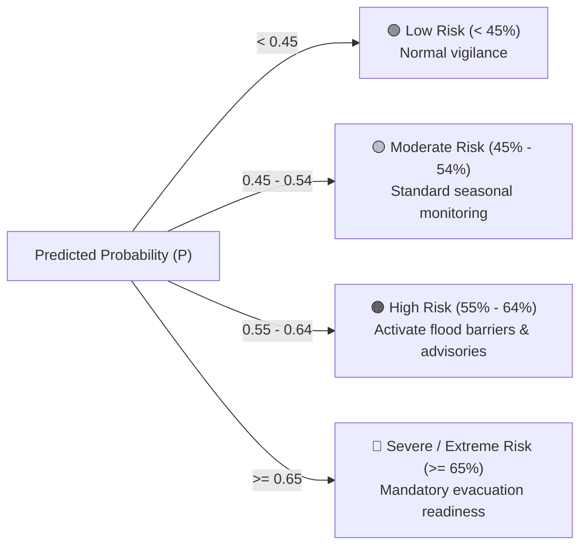

# 🌊 Flood Probability Prediction Project — NASA Space Project

A comprehensive end-to-end Machine Learning, REST API, and Full-Stack Integration system for predicting flood probability based on multi-factorial environmental, infrastructural, and socio-demographic indicators.

---

## 📌 Table of Contents
1. [Project Overview & Scientific Context](#-project-overview--scientific-context)
2. [Repository Directory Structure](#-repository-directory-structure)
3. [Dataset Architecture & Key Statistics](#-dataset-architecture--key-statistics)
4. [Machine Learning Experiments & Benchmarks (EXP-01 – EXP-11)](#-machine-learning-experiments--benchmarks-exp-01--exp-11)
5. [The Winning Model & Feature Engineering Secret](#-the-winning-model--feature-engineering-secret)
6. [FastAPI Backend Service (`api/`)](#-fastapi-backend-service-api)
   - [API Architecture & Pipeline](#api-architecture--pipeline)
   - [Environment Setup & Installation](#environment-setup--installation)
   - [Running the API Server](#running-the-api-server)
   - [API Endpoints Reference](#api-endpoints-reference)
   - [Validation & Error Handling](#validation--error-handling)
7. [Step-by-Step UI Integration Guide](#-step-by-step-ui-integration-guide)
   - [Enabling CORS in FastAPI (Crucial for Web Frontends)](#enabling-cors-in-fastapi-crucial-for-web-frontends)
   - [Frontend Architecture & Risk Classification](#frontend-architecture--risk-classification)
   - [Option A: Production Streamlit Dashboard (Python UI)](#option-a-production-streamlit-dashboard-python-ui)
   - [Option B: Modern Web UI (HTML5, TailwindCSS & Vanilla JavaScript)](#option-b-modern-web-ui-html5-tailwindcss--vanilla-javascript)
   - [Option C: React / Next.js Integration Guide](#option-c-react--nextjs-integration-guide)
   - [Option D: Gradio Interactive UI](#option-d-gradio-interactive-ui)
8. [Testing & Verification Guide](#-testing--verification-guide)
9. [Production Deployment Guide (Docker & Cloud)](#-production-deployment-guide-docker--cloud)

---

## 🌍 Project Overview & Scientific Context

Flooding represents one of the most devastating and recurrent natural disasters worldwide, exacerbated by climate change, unplanned urban growth, deteriorating infrastructure, and inadequate disaster management. 

This project formulates **Flood Risk Assessment** as a high-precision regression task:
- **Objective:** Predict the continuous `FloodProbability` (ranging from $0.0$ to $1.0$, typically concentrated between $0.28$ and $0.73$) based on 20 distinct environmental, topographical, infrastructural, and human-induced metrics.
- **Dataset Scale:** Over **1,117,957 training records** and **745,305 test records**.
- **Performance Milestone:** Achieved an $R^2 \approx 0.8685$ ($RMSE \approx 0.01849$) utilizing an optimized **LightGBM regressor coupled with aggregate statistical feature transformers**.
- **Production Asset:** An asynchronous, production-ready **FastAPI microservice** that validates input payloads, generates real-time predictions, and scales to batch scoring up to 1,000 instances per call.

---

## 📁 Repository Directory Structure

```plaintext
Flood_Prediction_Project/
│
├── api/                                # Production REST API microservice
│   ├── app.py                          # FastAPI application & endpoint definitions
│   ├── feature_engineering.py          # Custom scikit-learn aggregate feature transformer
│   ├── flood_model.joblib              # Serialized winning pipeline (LightGBM + Transformer)
│   ├── metadata.json                   # Model metadata, features list, and validation scores
│   └── requirements.txt                # Python dependencies for the API service
│
├── data/                               # Dataset storage (train, test, submissions)
│   ├── train.csv                       # Training dataset (1,117,957 rows × 22 columns)
│   ├── test.csv                        # Test evaluation dataset (745,305 rows × 21 columns)
│   ├── flood.csv                       # Consolidated reference dataset
│   └── sample_submission.csv           # Benchmark submission format
│
├── experiments/                        # Complete scientific experiment registry
│   ├── experiment_log.csv              # Summary registry of all 11 experimental runs
│   ├── EXP_01_Ridge/                   # Ridge regression baseline
│   ├── EXP_02_Linear_Regression/       # Ordinary Least Squares regression
│   ├── EXP_03_Decision_Tree/           # Single Decision Tree regressor
│   ├── EXP_04_Random_Forest/           # Random Forest ensemble
│   ├── EXP_05_XGBoost/                 # Gradient boosting (XGBoost)
│   ├── EXP_06A_LightGBM/               # LightGBM default boosting
│   ├── EXP_06B_CatBoost/               # CatBoost default boosting
│   ├── EXP_07_Ridge_Aggregates/        # Ridge with statistical aggregate features
│   ├── EXP_08_LightGBM_Tuned/          # Hyperparameter-tuned LightGBM
│   ├── EXP_09_Ridge_SumPoly/           # Ridge with polynomial of feature sum
│   ├── EXP_10_LightGBM_WithSum/        # 🏆 Winning Model: LightGBM + Aggregates
│   └── EXP_11_LightGBM_SumOnly/        # Ablation study: LightGBM with sum only
│       └── [Each EXP folder contains: cv_results.csv, cv_summary.csv, diagnostics.png, validation_metrics.csv]
│
├── final/                              # Final deployment artifacts
│   ├── best_model/                     # Model deployment specifications
│   │   ├── config.json                 # Hyperparameters, metrics, and pipeline steps
│   │   └── final_model.joblib          # Pickled pipeline artifact
│   └── submission.csv                  # Test predictions submission
│
├── outputs/                            # Visualizations, model exports, and data tables
│   ├── figures/                        # High-resolution analytic plots
│   │   ├── correlation_heatmap.png
│   │   ├── feature_distributions.png
│   │   ├── feature_target_correlation.png
│   │   ├── model_comparison.png
│   │   ├── permutation_importance.png
│   │   ├── permutation_importance_EXP10.png
│   │   ├── residuals_by_target_bin.png
│   │   ├── residuals_by_target_bin_EXP10.png
│   │   ├── ridge_residual_vs_sum.png
│   │   └── target_distribution.png
│   ├── models/                         # Trained model artifacts for all experiments
│   └── tables/                         # CSV analysis tables
│       ├── dataset_summary.csv
│       ├── descriptive_statistics.csv
│       ├── feature_target_correlation.csv
│       ├── lgbm_tuning_results.csv
│       ├── model_comparison.csv
│       ├── model_comparison_final.csv
│       └── permutation_importance_EXP10.csv
│
└── README.md                           # Master project documentation & integration guide
```

---

## 📊 Dataset Architecture & Key Statistics

### 1. The 20 Predictive Features
Every observation evaluates a geographic/regional zone across 20 numerical parameters (discrete integer scale typically $0$ to $19$, mean $\approx 4.94$, standard deviation $\approx 2.07$):

| # | Feature Name | Description | Min | Mean | Max |
|---|--------------|-------------|:---:|:----:|:---:|
| 1 | `MonsoonIntensity` | Severity and duration of monsoonal precipitation | 0 | 4.92 | 16 |
| 2 | `TopographyDrainage` | Natural terrain slope and runoff capacity | 0 | 4.93 | 18 |
| 3 | `RiverManagement` | Capacity, dredging, and channel stabilization of local rivers | 0 | 4.96 | 16 |
| 4 | `Deforestation` | Extent of canopy loss reducing water absorption | 0 | 4.94 | 17 |
| 5 | `Urbanization` | Percentage of impermeable artificial ground surface | 0 | 4.94 | 17 |
| 6 | `ClimateChange` | Frequency of extreme weather anomalies | 0 | 4.93 | 17 |
| 7 | `DamsQuality` | Structural integrity and reservoir buffer capacity | 0 | 4.96 | 16 |
| 8 | `Siltation` | Sediment buildup in riverbeds and retention basins | 0 | 4.93 | 16 |
| 9 | `AgriculturalPractices` | Runoff generation vs. conservation contouring in farming | 0 | 4.94 | 16 |
| 10 | `Encroachments` | Illegal construction on floodplains and retention paths | 0 | 4.95 | 18 |
| 11 | `IneffectiveDisasterPreparedness`| Gaps in early warning systems and evacuation logistics | 0 | 4.95 | 16 |
| 12 | `DrainageSystems` | Storm sewer efficiency and pump maintenance | 0 | 4.95 | 17 |
| 13 | `CoastalVulnerability` | Storm surge exposure and sea-level rise susceptibility | 0 | 4.95 | 17 |
| 14 | `Landslides` | Soil instability triggering river blockages | 0 | 4.93 | 16 |
| 15 | `Watersheds` | Catchment basin health and drainage integrity | 0 | 4.93 | 16 |
| 16 | `DeterioratingInfrastructure` | Aging levees, culverts, and water barriers | 0 | 4.93 | 17 |
| 17 | `PopulationScore` | Density of humans and assets in high-risk zones | 0 | 4.93 | 18 |
| 18 | `WetlandLoss` | Destruction of natural marsh and mangrove sponges | 0 | 4.95 | 19 |
| 19 | `InadequatePlanning` | Zoning violations and lack of flood mapping | 0 | 4.94 | 16 |
| 20 | `PoliticalFactors` | Policy gridlock, budget cuts, and regulatory laxity | 0 | 4.94 | 16 |

### 2. Target Variable: `FloodProbability`
- **Type:** Continuous Float ($[0.0, 1.0]$)
- **Minimum:** `0.285`
- **Mean:** `0.5045`
- **Maximum:** `0.725`
- **Distribution:** Symmetric bell-shaped distribution centered around $0.50$.
- **Individual Feature Correlation:** Uniform across all features, ranging from $0.1777$ (`CoastalVulnerability`) to $0.1900$ (`DeterioratingInfrastructure`).

---

## 🔬 Machine Learning Experiments & Benchmarks (EXP-01 – EXP-11)

A rigorous iterative benchmark was conducted on 11 distinct model configurations across $k$-fold cross-validation and independent validation hold-outs:

| Experiment | Model Architecture | Key Configuration / Strategy | CV $R^2$ | Val $R^2$ | Val RMSE | Val MAE | Train Time |
|:---|:---|:---|:---:|:---:|:---:|:---:|:---:|
| **EXP-10** | **LightGBM + Aggregates** 🏆 | **Sum, Std, Max, Min features + Tuned GBDT** | **0.8674** | **0.8685** | **0.01849** | **0.01440** | 49.1s |
| **EXP-11** | LightGBM (Sum Only) | Ablation study with only feature sum | 0.8653 | 0.8670 | 0.01859 | 0.01451 | 46.9s |
| **EXP-09** | Ridge (Sum Polynomial) | Ridge regression + degree-2 polynomial sum | 0.8492 | 0.8490 | 0.01981 | 0.01565 | 0.54s |
| **EXP-06B**| CatBoost Baseline | CatBoost on raw features | 0.8451 | 0.8452 | 0.02006 | 0.01589 | 56.4s |
| **EXP-07** | Ridge + Aggregates | Ridge with 4 statistical summary aggregates | 0.8451 | 0.8450 | 0.02007 | 0.01579 | 0.52s |
| **EXP-01** | Ridge Baseline | Standard $L_2$-penalized linear regression | 0.8450 | 0.8449 | 0.02008 | 0.01579 | 0.30s |
| **EXP-02** | Linear Regression | Ordinary Least Squares | 0.8450 | 0.8449 | 0.02008 | 0.01579 | 0.47s |
| **EXP-08** | LightGBM Tuned | Hyperparameter search without aggregates | 0.8376 | 0.8404 | 0.02037 | 0.01611 | 61.6s |
| **EXP-06A**| LightGBM Baseline | Default gradient boosted tree on raw features | 0.8337 | 0.8388 | 0.02047 | 0.01615 | 54.2s |
| **EXP-05** | XGBoost Baseline | XGBoost regressor on raw features | 0.8297 | 0.8354 | 0.02068 | 0.01647 | 31.4s |
| **EXP-04** | Random Forest | Bagging tree ensemble | 0.4897 | 0.5119 | 0.03562 | 0.02900 | 199.2s |
| **EXP-03** | Decision Tree | Single unconstrained decision tree | 0.2808 | 0.2842 | 0.04313 | 0.03469 | 6.8s |

---

## 💡 The Winning Model & Feature Engineering Secret

### 1. Why Did Trees Struggle Without Feature Engineering?
Standard decision trees split along single coordinate axes (e.g. `Deforestation > 5`). However, flood risk in this synthetic dataset exhibits an **underlying additive property**: the overall risk correlates strongly with the cumulative sum of risk factors across all 20 dimensions:
$$\text{Sum} = \sum_{i=1}^{20} \text{Feature}_i$$

Single-feature axis splits cannot efficiently compute an aggregate sum of 20 variables without thousands of deep, brittle orthogonal cuts.

### 2. The Feature Engineering Implementation (`api/feature_engineering.py`)
To solve this, a lightweight NumPy feature transformer generates 4 statistical summary metrics per record:
```python
import numpy as np

def add_aggregates(Z):
    """
    Transforms an (N, 20) feature matrix into an (N, 24) matrix
    by calculating the sum, standard deviation, maximum, and minimum
    across all input risk dimensions.
    """
    Z = np.asarray(Z, dtype=float)
    agg = np.column_stack([
        Z.sum(axis=1),
        Z.std(axis=1),
        Z.max(axis=1),
        Z.min(axis=1)
    ])
    return np.hstack([Z, agg])
```

### 3. Pipeline Specifications (`final/best_model/config.json`)
- **Step 1:** `FunctionTransformer(func=add_aggregates)` (Outputs 24 features)
- **Step 2:** `LGBMRegressor`:
  - `learning_rate`: `0.05`
  - `n_estimators`: `800`
  - `num_leaves`: `15`
  - `min_child_samples`: `200`
  - `subsample`: `0.9`
  - `subsample_freq`: `1`
  - `colsample_bytree`: `1.0`
  - `random_state`: `42`
- **Result:** $R^2$ jumped to **$0.8685$**, with validation RMSE dropping to **$0.01849$**.

---

## 🚀 FastAPI Backend Service (`api/`)

The API wraps the serialized LightGBM pipeline (`flood_model.joblib`) into a scalable RESTful microservice built with **FastAPI** and **Pydantic**.

### API Architecture & Pipeline

```mermaid
flowchart LR
    Client[UI / Client App] -->|HTTP POST JSON| FastAPI[FastAPI Server :8000]
    FastAPI -->|1. Validate Keys & Types| Pydantic[Pydantic Validation]
    Pydantic -->|2. Convert to DataFrame| DF[DataFrame 20 cols]
    DF -->|3. Feature Engineering| FE[add_aggregates FunctionTransformer]
    FE -->|4. Predict 24 cols| LGBM[LightGBM Model]
    LGBM -->|5. Clip [0, 1] & Format| Response[JSON: probability & percent]
    Response -->|HTTP 200 OK| Client
```

---

### Environment Setup & Installation

#### 1. Navigate to the API directory
```bash
cd "d:\NASA Space Project\final project\Flood_Prediction_Project\api"
```

#### 2. Create and activate a virtual environment
```bash
# On Windows:
python -m venv venv
.\venv\Scripts\activate

# On Linux / macOS:
python3 -m venv venv
source venv/bin/activate
```

#### 3. Install requirements
```bash
pip install -r requirements.txt
```
*(Dependencies: `fastapi`, `uvicorn[standard]`, `pandas`, `numpy`, `scikit-learn`, `lightgbm`, `joblib`)*

---

### Running the API Server

Launch the development server with live reload:
```bash
uvicorn app:app --host 0.0.0.0 --port 8000 --reload
```
Once started:
- **Root URL:** `http://localhost:8000/`
- **Interactive Swagger UI:** `http://localhost:8000/docs`
- **Alternative ReDoc UI:** `http://localhost:8000/redoc`

---

### API Endpoints Reference

#### 1. `GET /` — Root Status
Returns the server status and model identifier.
```http
GET http://localhost:8000/
```
**Response (200 OK):**
```json
{
  "message": "Flood Prediction API is running",
  "docs": "/docs",
  "model": "LightGBM_WithSum"
}
```

---

#### 2. `GET /health` — Health Check
Checks if the model is loaded into memory and ready for inference.
```http
GET http://localhost:8000/health
```
**Response (200 OK):**
```json
{
  "status": "healthy",
  "model_loaded": true,
  "model_name": "LightGBM_WithSum"
}
```

---

#### 3. `GET /schema` — Feature Metadata
Returns the exact list of 20 expected features in order.
```http
GET http://localhost:8000/schema
```
**Response (200 OK):**
```json
{
  "features": [
    "MonsoonIntensity",
    "TopographyDrainage",
    "RiverManagement",
    "Deforestation",
    "Urbanization",
    "ClimateChange",
    "DamsQuality",
    "Siltation",
    "AgriculturalPractices",
    "Encroachments",
    "IneffectiveDisasterPreparedness",
    "DrainageSystems",
    "CoastalVulnerability",
    "Landslides",
    "Watersheds",
    "DeterioratingInfrastructure",
    "PopulationScore",
    "WetlandLoss",
    "InadequatePlanning",
    "PoliticalFactors"
  ],
  "number_of_features": 20,
  "target": "FloodProbability"
}
```

---

#### 4. `POST /predict` — Single Record Inference
Predicts the probability of flooding for one location/zone.

```http
POST http://localhost:8000/predict
Content-Type: application/json
```

**Request Payload:**
```json
{
  "features": {
    "MonsoonIntensity": 5.0,
    "TopographyDrainage": 5.0,
    "RiverManagement": 5.0,
    "Deforestation": 5.0,
    "Urbanization": 5.0,
    "ClimateChange": 5.0,
    "DamsQuality": 5.0,
    "Siltation": 5.0,
    "AgriculturalPractices": 5.0,
    "Encroachments": 5.0,
    "IneffectiveDisasterPreparedness": 5.0,
    "DrainageSystems": 5.0,
    "CoastalVulnerability": 5.0,
    "Landslides": 5.0,
    "Watersheds": 5.0,
    "DeterioratingInfrastructure": 5.0,
    "PopulationScore": 5.0,
    "WetlandLoss": 5.0,
    "InadequatePlanning": 5.0,
    "PoliticalFactors": 5.0
  }
}
```

**Response Payload (200 OK):**
```json
{
  "success": true,
  "prediction": {
    "flood_probability": 0.505068,
    "flood_probability_percent": 50.51
  },
  "model": "LightGBM_WithSum"
}
```

---

#### 5. `POST /predict/batch` — Batch Inference (Up to 1000 items)
Accepts an array of feature dictionaries for high-throughput batch evaluation.

```http
POST http://localhost:8000/predict/batch
Content-Type: application/json
```

**Request Payload:**
```json
{
  "instances": [
    {
      "MonsoonIntensity": 3.0,
      "TopographyDrainage": 2.0,
      "RiverManagement": 4.0,
      "Deforestation": 3.0,
      "Urbanization": 2.0,
      "ClimateChange": 3.0,
      "DamsQuality": 4.0,
      "Siltation": 2.0,
      "AgriculturalPractices": 3.0,
      "Encroachments": 2.0,
      "IneffectiveDisasterPreparedness": 3.0,
      "DrainageSystems": 4.0,
      "CoastalVulnerability": 2.0,
      "Landslides": 2.0,
      "Watersheds": 3.0,
      "DeterioratingInfrastructure": 3.0,
      "PopulationScore": 3.0,
      "WetlandLoss": 2.0,
      "InadequatePlanning": 3.0,
      "PoliticalFactors": 3.0
    },
    {
      "MonsoonIntensity": 8.0,
      "TopographyDrainage": 7.0,
      "RiverManagement": 8.0,
      "Deforestation": 9.0,
      "Urbanization": 8.0,
      "ClimateChange": 8.0,
      "DamsQuality": 9.0,
      "Siltation": 7.0,
      "AgriculturalPractices": 8.0,
      "Encroachments": 9.0,
      "IneffectiveDisasterPreparedness": 8.0,
      "DrainageSystems": 8.0,
      "CoastalVulnerability": 9.0,
      "Landslides": 7.0,
      "Watersheds": 8.0,
      "DeterioratingInfrastructure": 9.0,
      "PopulationScore": 8.0,
      "WetlandLoss": 8.0,
      "InadequatePlanning": 9.0,
      "PoliticalFactors": 8.0
    }
  ]
}
```

**Response Payload (200 OK):**
```json
{
  "success": true,
  "count": 2,
  "predictions": [
    {
      "flood_probability": 0.407214,
      "flood_probability_percent": 40.72
    },
    {
      "flood_probability": 0.651493,
      "flood_probability_percent": 65.15
    }
  ],
  "model": "LightGBM_WithSum"
}
```

---

### Validation & Error Handling

The API strictly validates all incoming payloads:
- **Missing Features:** If any of the 20 features is missing, returns HTTP 400:
  ```json
  {"detail": "Missing features: ['MonsoonIntensity', 'PoliticalFactors']"}
  ```
- **Unexpected Features:** If unknown keys are included, returns HTTP 400:
  ```json
  {"detail": "Unexpected features: ['UnknownField']"}
  ```
- **Non-numeric / NaN / Infinite:** Rejects non-numeric or non-finite inputs with HTTP 400.
- **Batch Size Limit:** If `instances` exceeds 1,000 items, returns HTTP 400.

---

## 🖥️ Step-by-Step UI Integration Guide

Connecting a User Interface to the API requires sending an HTTP POST request with the 20 parameters formatted as a JSON object, receiving the response, and rendering the prediction.

### Enabling CORS in FastAPI (Crucial for Web Frontends)

> [!IMPORTANT]
> If your UI runs in a browser on a different port or origin (e.g. `localhost:3000`, `localhost:5173`, or `file://`), you **must enable CORS** in `api/app.py`.

In `api/app.py`, add `CORSMiddleware`:
```python
from fastapi.middleware.cors import CORSMiddleware

app = FastAPI(
    title="Flood Probability Prediction API",
    description="Predicts flood probability using a trained LightGBM model.",
    version="1.0.0"
)

# Enable CORS for frontend clients
app.add_middleware(
    CORSMiddleware,
    allow_origins=["*"],  # In production, replace with specific domain e.g. ["http://localhost:3000"]
    allow_credentials=True,
    allow_methods=["*"],
    allow_headers=["*"],
)
```

---

### Frontend Architecture & Risk Classification

To deliver actionable situational awareness, map the predicted continuous probability to risk categories:



---

### Option A: Production Streamlit Dashboard (Python UI)

Streamlit is the fastest way to build an interactive dashboard in pure Python.

#### 1. Install Streamlit
```bash
pip install streamlit requests
```

#### 2. Create `streamlit_app.py`
Place this file in your project root or `ui/` folder:

```python
import streamlit as st
import requests
import json
import pandas as pd

API_URL = "http://localhost:8000/predict"
BATCH_API_URL = "http://localhost:8000/predict/batch"

st.set_page_config(
    page_title="NASA Flood Risk Assessment System",
    page_icon="🌊",
    layout="wide"
)

st.title("🌊 NASA Flood Risk Assessment & Prediction System")
st.markdown("Assess regional flood vulnerability in real time using the NASA Machine Learning model.")

# Group the 20 features into 4 logical environmental categories
FEATURE_CATEGORIES = {
    "🌧️ Meteorological & Hydrological": [
        "MonsoonIntensity", "TopographyDrainage", "RiverManagement", 
        "DrainageSystems", "Watersheds"
    ],
    "🌲 Ecological & Environmental": [
        "Deforestation", "ClimateChange", "Siltation", 
        "AgriculturalPractices", "WetlandLoss"
    ],
    "🏙️ Infrastructure & Engineering": [
        "DamsQuality", "DeterioratingInfrastructure", "CoastalVulnerability", 
        "Landslides", "Urbanization"
    ],
    "🏛️ Socio-Political & Governance": [
        "Encroachments", "IneffectiveDisasterPreparedness", "PopulationScore", 
        "InadequatePlanning", "PoliticalFactors"
    ]
}

tab1, tab2 = st.tabs(["🎯 Single Region Assessment", "📁 Batch CSV Scoring"])

with tab1:
    st.subheader("Configure Environmental Risk Parameters (Scale 0 - 18)")
    
    col1, col2, col3, col4 = st.columns(4)
    feature_inputs = {}
    
    cols = [col1, col2, col3, col4]
    for idx, (category_name, features) in enumerate(FEATURE_CATEGORIES.items()):
        with cols[idx]:
            st.markdown(f"**{category_name}**")
            for feat in features:
                feature_inputs[feat] = st.slider(
                    label=feat,
                    min_value=0.0,
                    max_value=18.0,
                    value=5.0,
                    step=1.0,
                    help=f"Score for {feat}"
                )

    st.markdown("---")
    if st.button("🚀 Calculate Flood Risk Probability", type="primary", use_container_width=True):
        with st.spinner("Calling Prediction API..."):
            try:
                response = requests.post(
                    API_URL,
                    json={"features": feature_inputs},
                    timeout=10
                )
                
                if response.status_code == 200:
                    data = response.json()
                    prob = data["prediction"]["flood_probability"]
                    pct = data["prediction"]["flood_probability_percent"]
                    
                    st.success("✅ Prediction Successfully Computed")
                    
                    # Risk categorization
                    if prob < 0.45:
                        badge = "🟢 LOW RISK"
                        alert_func = st.success
                        advice = "Risk is below average. Regular monitoring recommended."
                    elif prob < 0.55:
                        badge = "🟡 MODERATE RISK"
                        alert_func = st.warning
                        advice = "Average seasonal vulnerability. Keep drainage systems inspected."
                    elif prob < 0.65:
                        badge = "🟠 HIGH RISK"
                        alert_func = st.error
                        advice = "High vulnerability! Inspect levees, clear silt, and prepare response teams."
                    else:
                        badge = "🔴 SEVERE / EXTREME RISK"
                        alert_func = st.error
                        advice = "CRITICAL ALERT: Multi-factorial flood risk is critical. Pre-emptive evacuation ready."

                    # Display metrics
                    mcol1, mcol2, mcol3 = st.columns(3)
                    mcol1.metric("Predicted Flood Probability", f"{prob:.4f}")
                    mcol2.metric("Probability Percentage", f"{pct:.2f}%")
                    mcol3.metric("Risk Level", badge)
                    
                    alert_func(f"**Actionable Advisory:** {advice}")
                    st.progress(min(prob, 1.0))
                else:
                    st.error(f"API Error ({response.status_code}): {response.text}")
            except Exception as e:
                st.error(f"Could not connect to API at {API_URL}. Ensure FastAPI is running! Error: {e}")

with tab2:
    st.subheader("Upload CSV file for Batch Prediction")
    uploaded_file = st.file_uploader("Upload CSV containing the 20 features", type=["csv"])
    if uploaded_file:
        df = pd.read_csv(uploaded_file)
        st.write("Preview of Uploaded Data:", df.head())
        
        if st.button("Run Batch Inference"):
            records = df.to_dict(orient="records")
            with st.spinner(f"Scoring {len(records)} instances..."):
                try:
                    resp = requests.post(BATCH_API_URL, json={"instances": records})
                    if resp.status_code == 200:
                        preds = resp.json()["predictions"]
                        df["FloodProbability"] = [p["flood_probability"] for p in preds]
                        df["FloodPercentage"] = [p["flood_probability_percent"] for p in preds]
                        st.dataframe(df)
                        csv_data = df.to_csv(index=False).encode("utf-8")
                        st.download_button(
                            "📥 Download Predictions CSV",
                            csv_data,
                            "flood_predictions.csv",
                            "text/csv"
                        )
                    else:
                        st.error(f"Batch Error: {resp.text}")
                except Exception as ex:
                    st.error(f"Batch request failed: {ex}")
```

#### 3. Run the Streamlit app
```bash
streamlit run streamlit_app.py
```

---

### Option B: Modern Web UI (HTML5, TailwindCSS & Vanilla JavaScript)

You can save this standalone `index.html` file anywhere and open it directly in Google Chrome, Edge, or Firefox.

```html
<!DOCTYPE html>
<html lang="en">
<head>
  <meta charset="UTF-8">
  <title>NASA Flood Probability AI Portal</title>
  <script src="https://cdn.tailwindcss.com"></script>
</head>
<body class="bg-slate-900 text-slate-100 min-h-screen py-10 px-4">
  <div class="max-w-5xl mx-auto bg-slate-800 rounded-2xl shadow-2xl p-8 border border-slate-700">
    
    <header class="mb-8 border-b border-slate-700 pb-5">
      <div class="flex items-center space-x-3">
        <span class="text-4xl">🌊</span>
        <div>
          <h1 class="text-3xl font-extrabold text-blue-400">NASA Flood Risk Assessment System</h1>
          <p class="text-slate-400 text-sm">Real-time inference driven by FastAPI & LightGBM Machine Learning Model</p>
        </div>
      </div>
    </header>

    <!-- Sliders Grid -->
    <form id="floodForm" class="space-y-6">
      <h2 class="text-xl font-semibold text-slate-200">Environmental & Infrastructural Indicators (0 to 18)</h2>
      <div id="slidersGrid" class="grid grid-cols-1 md:grid-cols-2 lg:grid-cols-4 gap-4">
        <!-- Dynamically injected by JavaScript -->
      </div>

      <button type="submit" id="submitBtn" class="w-full bg-blue-600 hover:bg-blue-500 text-white font-bold py-3 px-6 rounded-xl transition duration-200 flex justify-center items-center shadow-lg hover:shadow-blue-500/30">
        🚀 Calculate Flood Probability
      </button>
    </form>

    <!-- Result Box -->
    <div id="resultBox" class="mt-8 hidden p-6 rounded-xl border">
      <h3 class="text-lg font-semibold mb-2">Inference Result</h3>
      <div class="flex items-center justify-between mb-4">
        <div>
          <span class="text-sm text-slate-400">Probability:</span>
          <div id="probValue" class="text-4xl font-extrabold">--</div>
        </div>
        <div id="riskBadge" class="px-4 py-2 rounded-lg font-bold text-sm">--</div>
      </div>
      <div class="w-full bg-slate-700 h-4 rounded-full overflow-hidden">
        <div id="probBar" class="h-full bg-blue-500 transition-all duration-500" style="width: 0%"></div>
      </div>
    </div>

  </div>

  <script>
    const FEATURES = [
      "MonsoonIntensity", "TopographyDrainage", "RiverManagement", "Deforestation",
      "Urbanization", "ClimateChange", "DamsQuality", "Siltation",
      "AgriculturalPractices", "Encroachments", "IneffectiveDisasterPreparedness", "DrainageSystems",
      "CoastalVulnerability", "Landslides", "Watersheds", "DeterioratingInfrastructure",
      "PopulationScore", "WetlandLoss", "InadequatePlanning", "PoliticalFactors"
    ];

    const grid = document.getElementById("slidersGrid");

    // Populate sliders
    FEATURES.forEach(feature => {
      const card = document.createElement("div");
      card.className = "bg-slate-750 bg-slate-900/60 p-3 rounded-lg border border-slate-700 flex flex-col justify-between";
      card.innerHTML = `
        <div class="flex justify-between items-center mb-1">
          <label class="text-xs font-semibold text-slate-300">${feature}</label>
          <span id="val_${feature}" class="text-xs font-mono font-bold text-blue-400">5</span>
        </div>
        <input type="range" id="input_${feature}" min="0" max="18" value="5" step="1" 
          class="w-full h-1 bg-slate-700 rounded-lg appearance-none cursor-pointer accent-blue-500"
          oninput="document.getElementById('val_${feature}').textContent = this.value">
      `;
      grid.appendChild(card);
    });

    document.getElementById("floodForm").addEventListener("submit", async (e) => {
      e.preventDefault();
      const btn = document.getElementById("submitBtn");
      btn.disabled = true;
      btn.innerText = "Analyzing Indicators...";

      const payload = { features: {} };
      FEATURES.forEach(f => {
        payload.features[f] = parseFloat(document.getElementById(`input_${f}`).value);
      });

      try {
        const res = await fetch("http://localhost:8000/predict", {
          method: "POST",
          headers: { "Content-Type": "application/json" },
          body: JSON.stringify(payload)
        });

        if (!res.ok) {
          const err = await res.json();
          alert("Error: " + JSON.stringify(err));
          return;
        }

        const data = await res.json();
        const prob = data.prediction.flood_probability;
        const pct = data.prediction.flood_probability_percent;

        const box = document.getElementById("resultBox");
        const probValue = document.getElementById("probValue");
        const riskBadge = document.getElementById("riskBadge");
        const probBar = document.getElementById("probBar");

        box.classList.remove("hidden");
        probValue.textContent = `${pct}% (${prob.toFixed(4)})`;
        probBar.style.width = `${pct}%`;

        // Classification
        if (pct < 45) {
          box.className = "mt-8 p-6 rounded-xl border border-emerald-600 bg-emerald-950/30";
          riskBadge.className = "px-4 py-2 rounded-lg font-bold text-sm bg-emerald-700 text-emerald-100";
          riskBadge.textContent = "🟢 LOW RISK";
          probBar.className = "h-full bg-emerald-500 transition-all duration-500";
        } else if (pct < 55) {
          box.className = "mt-8 p-6 rounded-xl border border-amber-600 bg-amber-950/30";
          riskBadge.className = "px-4 py-2 rounded-lg font-bold text-sm bg-amber-700 text-amber-100";
          riskBadge.textContent = "🟡 MODERATE RISK";
          probBar.className = "h-full bg-amber-500 transition-all duration-500";
        } else if (pct < 65) {
          box.className = "mt-8 p-6 rounded-xl border border-orange-600 bg-orange-950/30";
          riskBadge.className = "px-4 py-2 rounded-lg font-bold text-sm bg-orange-700 text-orange-100";
          riskBadge.textContent = "🟠 HIGH RISK";
          probBar.className = "h-full bg-orange-500 transition-all duration-500";
        } else {
          box.className = "mt-8 p-6 rounded-xl border border-rose-600 bg-rose-950/30";
          riskBadge.className = "px-4 py-2 rounded-lg font-bold text-sm bg-rose-700 text-rose-100";
          riskBadge.textContent = "🔴 SEVERE / EXTREME RISK";
          probBar.className = "h-full bg-rose-500 transition-all duration-500";
        }

      } catch (err) {
        alert("Failed to connect to FastAPI server. Make sure it is running on http://localhost:8000 and CORS is enabled!");
      } finally {
        btn.disabled = false;
        btn.innerText = "🚀 Calculate Flood Probability";
      }
    });
  </script>
</body>
</html>
```

---

### Option C: React / Next.js Integration Guide

If building with React, create a custom hook or API service:

```typescript
// services/floodApi.ts
export interface FloodFeatures {
  MonsoonIntensity: number;
  TopographyDrainage: number;
  RiverManagement: number;
  Deforestation: number;
  Urbanization: number;
  ClimateChange: number;
  DamsQuality: number;
  Siltation: number;
  AgriculturalPractices: number;
  Encroachments: number;
  IneffectiveDisasterPreparedness: number;
  DrainageSystems: number;
  CoastalVulnerability: number;
  Landslides: number;
  Watersheds: number;
  DeterioratingInfrastructure: number;
  PopulationScore: number;
  WetlandLoss: number;
  InadequatePlanning: number;
  PoliticalFactors: number;
}

export interface PredictionResult {
  success: boolean;
  prediction: {
    flood_probability: number;
    flood_probability_percent: number;
  };
  model: string;
}

export async function predictFloodRisk(features: FloodFeatures): Promise<PredictionResult> {
  const response = await fetch("http://localhost:8000/predict", {
    method: "POST",
    headers: {
      "Content-Type": "application/json",
    },
    body: JSON.stringify({ features }),
  });

  if (!response.ok) {
    const errorData = await response.json();
    throw new Error(errorData.detail || "Prediction request failed");
  }

  return response.json();
}
```

---

### Option D: Gradio Interactive UI

To launch an instant browser UI in 15 lines of Python:

```python
import gradio as gr
import requests

FEATURES = [
    "MonsoonIntensity", "TopographyDrainage", "RiverManagement", "Deforestation",
    "Urbanization", "ClimateChange", "DamsQuality", "Siltation",
    "AgriculturalPractices", "Encroachments", "IneffectiveDisasterPreparedness", "DrainageSystems",
    "CoastalVulnerability", "Landslides", "Watersheds", "DeterioratingInfrastructure",
    "PopulationScore", "WetlandLoss", "InadequatePlanning", "PoliticalFactors"
]

def predict(*args):
    payload = {"features": {feat: val for feat, val in zip(FEATURES, args)}}
    res = requests.post("http://localhost:8000/predict", json=payload)
    if res.status_code == 200:
        data = res.json()["prediction"]
        return f"{data['flood_probability_percent']}%", data['flood_probability']
    return "Error", 0.0

inputs = [gr.Slider(0, 18, value=5, step=1, label=f) for f in FEATURES]
demo = gr.Interface(
    fn=predict,
    inputs=inputs,
    outputs=[gr.Label(label="Flood Risk Percentage"), gr.Number(label="Continuous Probability")],
    title="NASA Flood Risk Assessment Portal"
)

if __name__ == "__main__":
    demo.launch(server_port=7860)
```

---

## 🧪 Testing & Verification Guide

### 1. Test via cURL (Command Line)
```bash
curl -X POST "http://localhost:8000/predict" \
     -H "Content-Type: application/json" \
     -d "{\"features\": {\"MonsoonIntensity\": 5, \"TopographyDrainage\": 5, \"RiverManagement\": 5, \"Deforestation\": 5, \"Urbanization\": 5, \"ClimateChange\": 5, \"DamsQuality\": 5, \"Siltation\": 5, \"AgriculturalPractices\": 5, \"Encroachments\": 5, \"IneffectiveDisasterPreparedness\": 5, \"DrainageSystems\": 5, \"CoastalVulnerability\": 5, \"Landslides\": 5, \"Watersheds\": 5, \"DeterioratingInfrastructure\": 5, \"PopulationScore\": 5, \"WetlandLoss\": 5, \"InadequatePlanning\": 5, \"PoliticalFactors\": 5}}"
```

### 2. Test via Python `requests`
```python
import requests

payload = {
    "features": {f: 5.0 for f in [
        "MonsoonIntensity", "TopographyDrainage", "RiverManagement", "Deforestation",
        "Urbanization", "ClimateChange", "DamsQuality", "Siltation",
        "AgriculturalPractices", "Encroachments", "IneffectiveDisasterPreparedness",
        "DrainageSystems", "CoastalVulnerability", "Landslides", "Watersheds",
        "DeterioratingInfrastructure", "PopulationScore", "WetlandLoss",
        "InadequatePlanning", "PoliticalFactors"
    ]}
}

res = requests.post("http://localhost:8000/predict", json=payload)
print(res.status_code)
print(res.json())
```

---

## 🐳 Production Deployment Guide (Docker & Cloud)

### 1. Dockerfile
Create a `Dockerfile` inside the `api/` directory:
```dockerfile
FROM python:3.11-slim

WORKDIR /app

# Install system dependencies
RUN apt-get update && apt-get install -y --no-install-recommends \
    build-essential \
    libgomp1 \
    && rm -rf /var/lib/apt/lists/*

COPY requirements.txt .
RUN pip install --no-cache-dir -r requirements.txt

COPY . .

EXPOSE 8000

CMD ["uvicorn", "app:app", "--host", "0.0.0.0", "--port", "8000"]
```

### 2. Build and Run the Docker Container
```bash
docker build -t flood-prediction-api ./api
docker run -d -p 8000:8000 --name flood-api flood-prediction-api
```

### 3. Cloud Deployment
- **Render / Railway / Fly.io:** Point to the repository, set the root directory to `api`, and specify the start command:
  ```bash
  uvicorn app:app --host 0.0.0.0 --port $PORT
  ```
- **AWS ECS / GCP Cloud Run:** Push the container image to ECR or Google Artifact Registry and deploy with automatic scaling enabled.

---

## 🏆 Summary Checklist for Developers

- [x] **Model Selected:** `EXP-10 (LightGBM_WithSum)` ($R^2 = 0.8685$, $RMSE = 0.01849$).
- [x] **Feature Transformer:** `add_aggregates` generates `sum`, `std`, `max`, `min` dynamically on input arrays.
- [x] **FastAPI Service:** Validates all 20 required features, handles both single (`/predict`) and batch (`/predict/batch`).
- [x] **Frontend Ready:** Streamlit, HTML5/Tailwind/JS, React, and Gradio implementations provided.
- [x] **CORS Middleware:** Configurable in `app.py` for cross-origin browser requests.

# Nasa-Space-App

